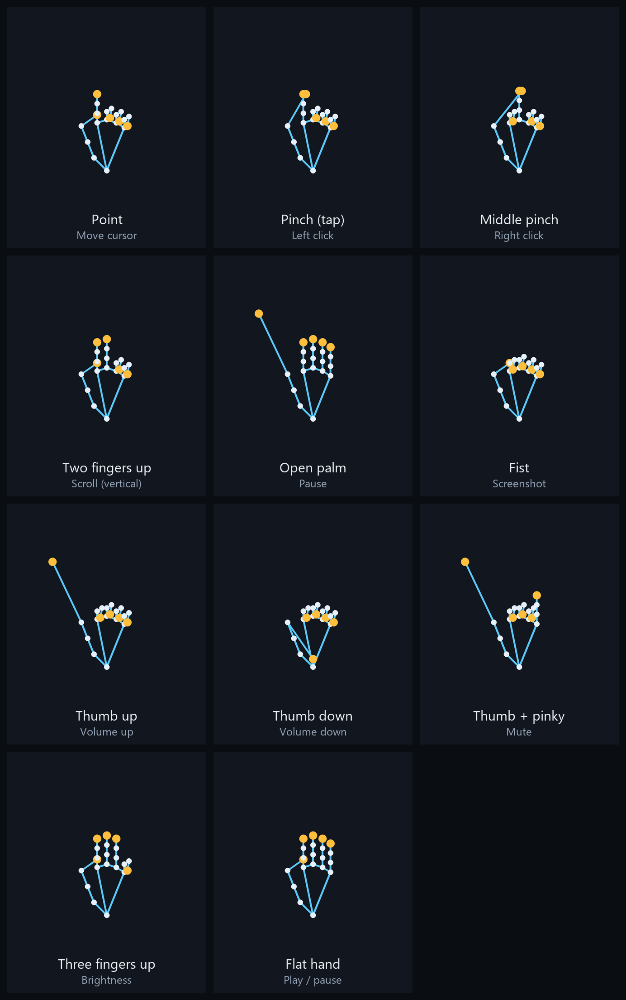

<div align="center">

# GestureFlow AI

**Control your Windows mouse with hand gestures through your webcam — running
entirely on your own computer.**

[](https://www.python.org/)
[](#6-prerequisites)
[](LICENSE)
[](#14-testing)
[](#16-privacy--security)

</div>


GestureFlow AI is a native Python desktop application. It captures your webcam
feed, detects your hand with MediaPipe's on-device landmark model, classifies
gestures with a geometric rule engine and a state machine, and drives the real
system cursor (move, click, drag, scroll, pause) via PyAutoGUI. Everything —
vision, recognition, control and statistics — happens locally. No frames are
uploaded, no telemetry is collected, and no network connection is made after
setup.

> **Honesty note:** this project is described as offline and private because
> that is how it is built. See [Privacy & Security](#16-privacy--security) for
> exactly what is stored and how to verify it. It is not a medical or
> accessibility-certified device; test it in a safe window before relying on it.

---

## Quick start

```powershell
git clone https://github.com/umemuqadus/GestureFlow.git
cd GestureFlow

python -m venv .venv
.\.venv\Scripts\Activate.ps1

pip install -r requirements.txt
python scripts/download_model.py     # one-time model download (the only network step)
python main.py
```

Requirements: Windows 10/11, Python 3.11+ (3.12 recommended), a webcam.
Full, step-by-step instructions (including PowerShell execution-policy notes)
are in [§7 Windows setup](#7-windows-setup).

---

## Table of contents

1. [Project overview](#1-project-overview)
2. [Features](#2-features)
3. [Screenshots](#3-screenshots)
4. [Architecture](#4-architecture)
5. [Technology stack](#5-technology-stack)
6. [Prerequisites](#6-prerequisites)
7. [Windows setup](#7-windows-setup)
8. [Virtual environment](#8-virtual-environment)
9. [Dependency installation](#9-dependency-installation)
10. [Launch](#10-launch)
11. [Gesture reference](#11-gesture-reference)
12. [Configuration guide](#12-configuration-guide)
13. [Keyboard shortcuts](#13-keyboard-shortcuts)
14. [Testing](#14-testing)
15. [Troubleshooting](#15-troubleshooting)
16. [Privacy & security](#16-privacy--security)
17. [Performance & limitations](#17-performance--limitations)
18. [Optional ML training](#18-optional-ml-training)
19. [Packaging (PyInstaller)](#19-packaging-pyinstaller)
20. [Future improvements](#20-future-improvements)
21. [Contributing](#contributing)
22. [Acknowledgements](#acknowledgements)

---

## 1. Project overview

**Problem:** controlling a computer with a mouse is not always possible or
convenient — for presenters, hobbyists, or hands-busy workflows.

**Approach:** a webcam sees your hand. MediaPipe's `HandLandmarker` returns 21
landmarks per hand, entirely on-device. A geometric classifier turns those
landmarks into a gesture (point, pinch, two-finger scroll, open palm, …). A
state machine arbitrates those gestures into exactly one mouse action per frame,
with debouncing, cooldowns, hysteresis and drag/tap timing. A safety manager
guarantees buttons are released whenever tracking is lost, control is paused, or
the app closes.

**Key design points**

- **Works out of the box** — no training, no dataset, no GPU required. The
  landmark model ships with MediaPipe; gesture rules are geometric.
- **Safety first** — mouse automation never starts automatically; there is an
  emergency stop, a PyAutoGUI corner failsafe, and fail-closed release logic.
- **Real product structure** — modular packages for vision, gestures, control,
  services, persistence and UI; SQLite persistence; pytest coverage; logging.

**How recognition works (important):** the base controller uses MediaPipe's
*pretrained* hand-landmark model plus *geometric rules* — no model of our own is
trained or required. An optional scikit-learn classifier can be layered on later
(see §18); the rule-based recognizer remains the always-available fallback.

---

## 2. Features

- **Cursor movement** — index fingertip maps to the screen, with adjustable
  speed, smoothing (EMA or adaptive One Euro filter), a movement dead-zone, and
  an adjustable active tracking region.
- **Left click** — a quick thumb+index pinch ("tap").
- **Double click** — two quick taps within a configurable window.
- **Right click** — thumb+middle pinch (middle finger reaching), kept distinct
  from left click and scroll.
- **Drag & drop** — *hold* the pinch: the button is pressed after the drag-hold
  time and released when you let go. A tap never drags; a hold never clicks.
- **Vertical & horizontal scroll** — index+middle up (ring/pinky down); move the
  hand to scroll, with adjustable sensitivity and a dead-zone.
- **Pause / resume** — hold an open palm for a set time to pause; hold it again
  (or use the hotkey / Resume button) to resume.
- **System control (non-mouse actions)** — all offline, all optional and
  individually switchable on the Gesture Mapping page:
  - **Screenshot** — clench a fist (thumb tucked) to capture the screen; saved
    to `%APPDATA%\GestureFlowAI\screenshots`.
  - **Volume up / down** — thumb up to raise, thumb down to lower; keep holding
    to repeat (sends the Windows volume media keys).
  - **Mute** — thumb + pinky out ("shaka") toggles mute.
  - **Brightness up / down** — index + middle + ring up (pinky down), move your
    hand up or down; uses WMI on internal laptop panels and reports itself
    unavailable on displays that don't expose brightness.
  - **Play / pause media** — four fingers up with the thumb tucked toggles
    playback.
- **On-screen level indicator** — raising or lowering volume (thumb up/down)
  or brightness (three fingers up, move your hand) pops a fading indicator at
  the bottom centre of the screen: a drawn sun or speaker glyph plus a progress
  bar, so you can see exactly where the level landed. The volume value is read
  back from Windows Core Audio through `ctypes` (no extra dependency) and the
  brightness value comes from the same WMI call that sets it; when a level
  cannot be read the indicator simply stays hidden instead of showing a number
  that was not measured. Volume is stepped straight through Core Audio rather
  than with synthetic volume keys, so Windows' own volume OSD does not pop up
  next to this indicator; the media keys remain as a fallback on setups where
  Core Audio is unavailable.
- **Live controller page** — real webcam preview with landmark overlay, live
  FPS, latency, tracking confidence and the current gesture.
- **Calibration wizard** — guided steps with live pinch-distance feedback to
  match the controller to your hand and screen.
- **Gesture mapping page** — view and retune thresholds, hold times, cooldowns
  and per-gesture enable switches; validates conflicting mappings.
- **Settings** — camera, resolution, confidences, cursor feel, gesture timings,
  safety options and theme (light/dark); persisted per profile in SQLite.
- **Session history** — real session summaries (duration, clicks, scrolls,
  tracking-loss events, average FPS) stored locally; clearable.
- **Profiles** — switchable sets of settings and mappings.
- **Global hotkeys** — start/stop, pause, emergency stop, calibration, quit
  (system-wide on Windows via `RegisterHotKey`; no extra dependency, no admin).
- **Safety** — explicit start, visible running/paused status, emergency stop,
  pause-on-focus-loss option, held-button release on every failure path, and
  PyAutoGUI's corner failsafe left enabled by default.

---

## 3. Screenshots

**Already in this repo:** the gesture reference sheet in
[`docs/gestures/`](docs/gestures/) — one rendered illustration per gesture
(`point.png`, `pinch_tap.png`, `two_fingers_up.png`, …), plus the combined
`all_gestures.png` used in §11. They are generated by
`scripts/render_gesture_reference.py`, so they always match the shipped
gesture set.

This repository does **not** ship fabricated application screenshots. Capture
your own after running the app (instructions below) and drop them into
`assets/images/`:

1. Launch the app (`python main.py`).
2. Open **Live Controller**, click **Start Controller**, and show your hand so
   landmarks appear. Press `Win + Shift + S` (Snipping Tool) to capture.
3. Capture the **Dashboard** with live metrics during a session.
4. Capture the **Calibration** wizard mid-flow and the **Gesture Mapping** page.
5. Optional: switch to the dark theme in **Settings** and capture that too.

Suggested filenames: `dashboard.png`, `live-controller.png`,
`calibration.png`, `gestures.png`, `settings-dark.png`.

---

## 4. Architecture

```
gestureflow-ai/
├── main.py                     # entry point: builds QApplication + Application + MainWindow
├── app/
│   ├── application.py          # composition root: wires services, safety, engine, hotkeys
│   ├── config.py               # AppConfig dataclass tree + validation
│   └── constants.py            # landmark ids, gesture/state/action ids, defaults
├── ui/                         # PySide6 (no vision/control logic)
│   ├── main_window.py          # sidebar navigation + stacked pages + safe shutdown
│   ├── dashboard_page.py       # status, live metrics, recent sessions
│   ├── controller_page.py      # live webcam preview + run controls
│   ├── calibration_page.py     # guided calibration with live feedback
│   ├── gestures_page.py        # gesture -> action mapping editor
│   ├── settings_page.py        # persistent settings
│   ├── history_page.py         # stored session summaries
│   ├── about_page.py           # version, stack, privacy, shortcuts
│   ├── components.py           # Card, StatTile, SliderRow, Toggle, Pill, …
│   ├── screenshot_overlay.py    # fading on-screen thumbnail after a capture
│   ├── level_overlay.py         # fading volume/brightness level indicator
│   ├── theme.py + styles.qss   # light/dark theming via token substitution
├── vision/                     # capture + landmarks (no Qt, no mouse)
│   ├── camera_manager.py       # device enumeration, open/read/release, retries
│   ├── hand_tracker.py         # MediaPipe Tasks HandLandmarker (local model)
│   ├── landmark_processor.py   # pure geometry: distances, extension, angles
│   ├── frame_processor.py      # capture -> track -> annotate
│   └── types.py                # HandObservation
├── gestures/                   # recognition + arbitration (pure Python)
│   ├── gesture_rules.py        # geometric predicates + priority
│   ├── gesture_classifier.py   # hysteresis / latching
│   ├── gesture_state.py        # state machine: one action per frame
│   └── gesture_config.py       # per-gesture rules + mapping validation
├── controller/                 # mouse control + safety
│   ├── coordinate_mapper.py    # normalised frame -> screen pixels (ROI, speed, clamp)
│   ├── cursor_smoother.py      # EMA + One Euro filter
│   ├── mouse_controller.py     # PyAutoGUI wrapper with held-button bookkeeping
│   ├── safety_manager.py       # pause / emergency stop / release guarantees
│   ├── system_controller.py    # screenshot / volume / brightness / media (offline)
│   └── engine.py               # QThread running the capture->control loop
├── services/                   # settings, calibration, statistics, profiles
├── database/                   # SQLite manager, schema, repositories
├── utils/                      # logging, metrics, platform paths, global hotkeys
├── tests/                      # pytest suite (no webcam / no real mouse required)
├── scripts/download_model.py   # ONE-TIME model download (explicit setup step)
└── assets/models/              # hand_landmarker.task (fetched by the script)
```

**Data flow (one frame):** `CameraManager.read()` → `HandTracker.process()` →
`GestureClassifier.classify()` → `GestureStateMachine.update()` → engine
executes at most one action through `MouseController`, gated by
`SafetyManager`; frames/metrics are emitted to the UI via Qt signals. The engine
runs on a `QThread`; the GUI thread is never blocked by capture.

**Threading:** camera + vision + control run in one worker thread
(`ControllerEngine`). UI updates happen only via queued Qt signals. Workers shut
down cleanly (`request_stop()` + `wait()`), and teardown always releases buttons.

---

## 5. Technology stack

| Layer          | Choice                         | Why |
|----------------|--------------------------------|-----|
| Language       | Python 3.12                    | Broad CV/tooling support on Windows |
| Vision         | OpenCV + MediaPipe (Tasks API) | On-device hand landmarks, no GPU needed |
| Numerics       | NumPy                          | Fast array handling |
| Mouse control  | PyAutoGUI                      | Real cursor/click/drag/scroll + corner failsafe |
| UI             | PySide6 (Qt for Python)        | Native, responsive desktop UI with threads |
| Persistence    | SQLite (stdlib `sqlite3`)      | Zero-config local storage |
| Tests          | Pytest                         | Fixtures, parametrisation |
| Packaging      | PyInstaller (optional)         | Standalone `.exe` |
| Global hotkeys | Win32 `RegisterHotKey` (ctypes)| System-wide, no extra dep, no admin |
| System control | PyAutoGUI media keys + `wmi`  | Volume/mute stepped via Core Audio (`ctypes`) so the shell's own volume OSD never competes with the app's indicator (media VKs as fallback); play-pause via media VKs; brightness via WMI on laptop panels; screenshots via Pillow |

**Tested versions (this machine):** Python 3.12.10, mediapipe 0.10.35,
numpy 2.2.6, opencv-contrib-python 5.0.0.93, PySide6 6.12.0, PyAutoGUI 0.9.54,
pytest 9.1.1, pyinstaller 6.22.3.

---

## 6. Prerequisites

- **Windows 10 or 11** (primary target). Global hotkeys use the Win32 API;
  other OSes would need a different hotkey backend.
- **Python 3.11+** (3.12 recommended) on `PATH`.
- A **webcam** and permission for desktop apps to use it (Settings → Privacy →
  Camera).
- No GPU required. No admin rights required.

---

## 7. Windows setup

Open **PowerShell** and run these commands from the project folder.

### 7.1 Allow virtual-environment activation (if PowerShell blocks it)

If you see *"running scripts is disabled on this system"*, use a **temporary,
process-only** policy change (nothing permanent, no admin needed):

```powershell
Set-ExecutionPolicy -Scope Process -ExecutionPolicy Bypass
```

Verify with `Get-ExecutionPolicy` (it should show `Bypass` for this window only).

### 7.2 Clone / enter the project

```powershell
cd "C:\path\to\GestureFlow"
```

### 7.3 Create and activate a virtual environment

```powershell
python -m venv .venv
.\.venv\Scripts\Activate.ps1
```

Your prompt should now be prefixed with `(.venv)`.

### 7.4 Install dependencies

```powershell
python -m pip install --upgrade pip
pip install -r requirements.txt
```

For development/tests and packaging, also:

```powershell
pip install -r requirements-dev.txt
```

### 7.5 Download the hand-landmark model (one time)

This is the **only** step that touches the network. It fetches MediaPipe's
`hand_landmarker.task` once into `assets/models/`; after that the app is fully
offline.

```powershell
python scripts/download_model.py
```

### 7.6 Run

```powershell
python main.py
```

See §10 for first-run guidance.

---

## 8. Virtual environment

A virtual environment keeps GestureFlow AI's packages isolated from your system
Python.

```powershell
# create
python -m venv .venv
# activate (each new terminal)
.\.venv\Scripts\Activate.ps1
# deactivate
deactivate
```

Everything below assumes the venv is active (you can also call
`.\.venv\Scripts\python.exe main.py` directly without activating).

---

## 9. Dependency installation

```powershell
python -m pip install --upgrade pip
pip install -r requirements.txt        # runtime
pip install -r requirements-dev.txt    # + pytest, pyinstaller
python scripts/download_model.py       # one-time model fetch
```

**What gets installed and why**

- `mediapipe` — on-device `HandLandmarker` (Tasks API).
- `numpy`, `opencv-contrib-python` — array + image handling (mediapipe needs them).
- `PySide6-Essentials` — Qt widgets for the UI (QtCore/QtGui/QtWidgets). If you
  prefer, install the full `pyside6` metapackage; it just adds optional modules
  (e.g. WebEngine) that GestureFlow AI does not use.
- `PyAutoGUI` — real mouse control with a built-in failsafe.
- `pytest`, `pyinstaller` — testing and packaging (dev only).

> **Note on MediaPipe versions:** the app uses the modern **Tasks API**
> (`mediapipe.tasks.python.vision.HandLandmarker`). The older
> `mp.solutions.*` API was removed in current MediaPipe releases, which is why
> `requirements.txt` pins `mediapipe>=0.10.20,<1.0` and the model is downloaded
> separately by the setup script instead of being bundled.

---

## 10. Launch

```powershell
python main.py
```

**First run — do this in order (safety):**

1. On the **Dashboard**, review **Settings** if you like, but keep **PyAutoGUI
   failsafe** enabled and **Pause when window loses focus** enabled.
2. Go to **Live Controller** → choose your camera → **Start Controller**.
3. **Test cursor movement only first.** Point your index finger and confirm the
   cursor follows smoothly. Keep your other fingers relaxed.
4. Only once movement feels right, test a **tap** (quick thumb+index pinch) to
   click, then **hold-pinch** to drag, then two-finger **scroll**.
5. Keep the **Emergency Stop** hotkey (`Esc`) and the on-screen **Emergency
   Stop** button in mind. Moving your mouse to the **top-left corner** of the
   screen also triggers PyAutoGUI's failsafe.
6. The controller does **not** start on launch — you must click **Start
   Controller** (or press `Ctrl + Alt + M`) explicitly.

---

## 11. Gesture reference



| Gesture | How to do it | Result | Key settings |
|---------|--------------|--------|--------------|
| **Point** | Index up, other fingers relaxed/curled | Move cursor | Cursor speed, smoothing, tracking region, dead zone |
| **Pinch (tap)** | Briefly touch thumb+index, then release | Left click | Pinch threshold, release (hysteresis), cooldown |
| **Hold pinch** | Keep thumb+index pinched past the drag time | Drag (button held while moving; releases on let-go) | Drag hold time |
| **Two quick pinches** | Two short taps inside the window | Double click | Double-click window |
| **Middle pinch** | Thumb+middle touch (middle reaching, index curled) | Right click | Right-pinch threshold |
| **Two fingers up** | Index+middle up, ring/pinky down; move hand | Vertical scroll | Scroll sensitivity, dead zone |
| **Two fingers sideways** | Same, hand tilted so motion is horizontal | Horizontal scroll | Same scroll settings |
| **Open palm** | Hold an open palm for the set time | Pause (hold again to resume) | Pause hold duration |
| **Fist** | Clench a fist (thumb tucked) and hold | Screenshot | System hold time |
| **Thumb up** | Curled hand, thumb raised above the knuckles; hold to repeat | Volume up | System hold, repeat interval |
| **Thumb down** | Curled hand, thumb dropped below the knuckles; hold to repeat | Volume down | System hold, repeat interval |
| **Thumb + pinky** | Thumb and pinky out, other three curled | Mute toggle | System hold time |
| **Three fingers up** | Index+middle+ring up (pinky down); move hand up/down | Brightness up / down | System hold, step interval |
| **Flat hand** | Four fingers up, thumb tucked | Play / pause media | System hold time |

**Precedence & disambiguation (by design):** two-fingers-up is treated as
*scroll*, not pinch. A *tap* (quick pinch) clicks; a *held* pinch drags — so a
drag never emits a stray click and a hold never spams clicks. Right-click needs
the middle finger reaching toward the thumb, so a resting middle finger in a
point/fist pose can't trigger it. The system gestures are matched *after* the
click/pinch rules and are mutually exclusive with point/scroll by finger count,
so a click is never stolen; volume gestures require the thumb to clear the
knuckle line, which keeps a plain fist (screenshot) from being read as a
direction. When the hand disappears, any held button is released and no new
actions fire until tracking returns.

---

## 12. Configuration guide

Settings are per-profile and persisted in SQLite. Changes on the **Settings**
and **Gesture Mapping** pages apply to the running controller immediately.

**Camera** — device, capture resolution (640×480 / 1280×720 / 1920×1080), max
FPS, mirror preview, landmark overlay.

**Hand tracking** — detection & tracking confidence (0–1). Lower = more
sensitive but twitchier; raise it if gestures fire too easily.

**Cursor** — speed (multiplies sensitivity around the region centre), smoothing
(0 = raw … ~0.95 = very heavy), tracking region (fraction of the frame mapped to
the full screen), movement dead zone (ignores sub-pixel jitter), and an
optional adaptive **One Euro** filter (light filtering when moving fast, heavy
when still).

**Gestures** — pinch sensitivity (threshold), click cooldown, drag hold time,
scroll sensitivity.

**Safety** — pause on focus loss, PyAutoGUI failsafe. Turning the failsafe off
asks for confirmation.

**Appearance** — light/dark theme, start minimized.

**Where data lives:** `%APPDATA%\GestureFlowAI` (database `gestureflow.db` and
`logs\gestureflow.log`). Delete that folder to remove everything. See §16.

Reset: **Settings → Reset to defaults** (with confirmation), or **Gesture
Mapping → Reset to defaults**.

---

## 13. Keyboard shortcuts

These are registered **system-wide** on Windows (via `RegisterHotKey`), so they
work even when the window is not focused:

| Shortcut | Action |
|----------|--------|
| `Ctrl + Alt + M` | Start / stop the controller |
| `Ctrl + Alt + P` | Pause / resume control |
| `Esc` | **Emergency stop** — halts automation and releases held buttons |
| `Ctrl + Alt + C` | Open the calibration flow |
| `Ctrl + Alt + Q` | Quit after safe cleanup |

**Fallback:** if a combination is already owned by another program, registration
fails (logged) and the on-screen buttons still work. `Esc` is also bound as an
in-window action. We do **not** claim a shortcut is global if Windows refused to
register it — the log records any that could not be taken.

---

## 14. Testing

Run the suite (no webcam and no real mouse movement required — mouse calls are
backed by a fake, and gestures use synthetic hands):

```powershell
python -m pytest tests -v
```

**What is covered:** landmark geometry & finger/pinch analysis, gesture
classification & hysteresis (including the system poses and that they never
collide with point/scroll/pinch/palm), state-machine transitions (tap vs drag,
double click, cooldowns, pause, tracking loss releasing the button, plus the
system actions' hold-to-trigger, once-per-hold discrete firing, volume repeat
and brightness movement/rate-limiting), coordinate mapping
(including ROI, speed, inversion, clamping), cursor smoothing (EMA + One Euro),
settings validation, SQLite persistence (profiles, settings, mappings,
calibration, sessions), profile management, mapping-conflict validation,
safety-manager emergency/pause/release guarantees, mouse-controller
held-button bookkeeping, the `SystemController` against an injected fake backend
(screenshot file creation, brightness clamping and unsupported-display
handling), the volume path's guarantee that the happy route steps through Core
Audio and sends no media key — a synthetic `VK_VOLUME_*` press is what makes
Windows show its own volume OSD beside the app's indicator — with the media
keys covered as the fallback, the level bookkeeping behind the on-screen
indicator (read-back vs. predicted volume, mute flag, brightness steps and the
"unknown level stays hidden" rule) and the indicator overlay itself (offscreen
construction, level clamping, theme switching), a deterministic
**integration test** that wires the
classifier → state machine → mapper → smoother → fake mouse → safety manager,
and an engine-level check that each system action reaches the controller.

**Manual / hardware-dependent checks** (documented, not automated):

- Opening a *real* webcam, streaming real frames, and detecting a real hand.
- The engine `QThread` end-to-end with a live camera.
- True global hotkeys (needs a real desktop session).
- Actual cursor movement/latency on your specific display/DPI.
- The *feel* of the new system gestures and the real OS effect of a volume /
  brightness / screenshot / media action on your machine.

**Count on this machine: 160 passed.**

---

## 15. Troubleshooting

**"Could not open camera" / black preview**
- Close other apps using the camera (Teams, Zoom, browser tabs).
- Check Settings → Privacy → Camera allows desktop apps.
- Try a different device index / resolution, then **Refresh cameras**.

**No hand detected**
- Improve lighting; use a plain background; keep the whole hand in frame.
- Lower **Detection confidence** slightly.
- Make sure the camera isn't mirrored in a way that confuses you (the preview
  is mirrored by default; mapping is handled internally).

**Cursor jittery or too slow**
- Increase **Smoothing**, or enable the One Euro filter.
- Raise the **movement dead zone**.
- Adjust **Cursor speed** and the **tracking region** on the Calibration page.

**Clicks fire too easily / not easily enough**
- Tune the **pinch threshold** using the live pinch-distance read-out on the
  Calibration page; keep the **release** threshold above it (hysteresis).
- Increase the **click cooldown**.

**Drag doesn't release / button stuck** — this should not happen; the app
releases buttons on tracking loss, pause, stop and close. If it ever does, press
`Esc` (emergency stop) or move the mouse to the **top-left corner** (PyAutoGUI
failsafe). Report it as a bug.

**Hotkey does nothing** — another program may own it; check the log at
`%APPDATA%\GestureFlowAI\logs\gestureflow.log`. Use the on-screen buttons.

**MediaPipe import / model errors** — re-run `python scripts\download_model.py`
and confirm `assets\models\hand_landmarker.task` exists.

**PowerShell activation blocked** — see §7.1 (`Set-ExecutionPolicy -Scope
Process -ExecutionPolicy Bypass`).

**Slow FPS** — lower the capture resolution / processing width, close other
camera apps, and reduce detection complexity. See §17.

---

## 16. Privacy & security

GestureFlow AI is built to be verifiably local:

- **No network after setup.** The only network access in the whole project is
  the explicit, user-run `scripts/download_model.py` during installation. The
  application itself opens no sockets, makes no HTTP requests, and has no
  update checker.
- **No telemetry / analytics / crash reporting / ads / cloud APIs — in this
  app's own code.** GestureFlow AI's source makes zero network calls and ships
  no analytics of its own. One honest caveat about a *dependency*: MediaPipe
  (Google's hand-tracking library) bundles an **anonymized usage-metrics**
  uploader (`portable_clearcut_uploader`) that may attempt to reach a Google
  endpoint to report library usage. It sends **no images, no webcam frames and
  no user data**, lives entirely inside the MediaPipe binary (not in this app),
  and cannot succeed in the offline setup this app is built for — you will see
  it logged as `Failed to send to clearcut`. There is no supported switch to
  disable it for the Tasks API; simply running the app offline (its normal mode)
  prevents it. We state this rather than claim a blanket "nothing in any
  dependency phones home", because that would be inaccurate.
- **Webcam stays local.** Frames are processed in memory on your machine and
  never uploaded, streamed, or written to disk. No video or webcam images are
  ever saved.
- **Screenshots are a separate, user-triggered feature.** The screenshot gesture
  captures your *desktop* (not the webcam) and writes a PNG to
  `%APPDATA%\GestureFlowAI\screenshots`. Nothing is captured unless you perform
  the gesture, and you can delete the folder at any time.
- **What is stored, and where** (all under `%APPDATA%\GestureFlowAI`):
  - `gestureflow.db` (SQLite) — profiles, settings, gesture mappings,
    calibration values, and **session summaries** (start/end times, duration,
    click/scroll/drag counts, tracking-loss count, frames, average FPS). No
    frame data, no personal content.
  - `screenshots\` — PNG files you captured with the screenshot gesture.
  - `logs\gestureflow.log` — diagnostic text (module messages, errors). Rotated
    (3×512 KiB). Contains **no** webcam frames, screenshots, or personal data.
- **What is *never* collected:** keystrokes, clipboard, browser history,
  documents, passwords, or unrelated application data. The global hotkeys only
  detect the specific registered combinations; they do not log other keys.
- **Delete everything:** remove the `%APPDATA%\GestureFlowAI` folder, or use
  *Clear history* / *Reset settings* in the app.

**How to verify (encouraged):**

- Grep the source for network calls: `requests`, `urllib`, `socket`, `http`.
  The only occurrence is inside `scripts/download_model.py` (setup only).
- Watch network activity with Resource Monitor / Wireshark while using the app —
  you should see none after startup.
- Inspect `%APPDATA%\GestureFlowAI` to see exactly what's written.
- `requirements.txt` lists every runtime dependency; none is a telemetry SDK.

**Safety:** automation never starts on launch; there is a visible running/paused
state, an emergency stop (`Esc` + button), held-button release on every failure
path, optional pause-on-focus-loss, and PyAutoGUI's corner failsafe (enabled by
default — do not disable it casually). No admin privileges are requested.

---

## 17. Performance & limitations

**Targets vs reality.** The engine paces to your configured max FPS and displays
**measured** FPS and latency — it never fabricates numbers. On a typical modern
laptop CPU, MediaPipe HandLandmarker at 640×480 usually runs well above real-time
for a single hand, but exact FPS depends on your CPU, camera, resolution, and
display scaling.

**Known limitations (honest):**

- **Single hand** by default (configurable up to 4, but control uses one).
- **Webcam-dependent.** Lighting, background clutter, skin tone, occlusion and
  motion blur affect accuracy. Expect occasional misdetection; the state machine,
  thresholds and cooldowns exist to absorb this.
- **Gesture set is rule-based.** Exotic or subtle gestures are not recognized
  out of the box (that's what the optional ML extension in §18 is for).
- **Windows-first.** Global hotkeys and DPI handling target Windows; other OSes
  would need a hotkey backend and testing.
- **DPI scaling** is handled by mapping into PyAutoGUI's coordinate space and
  enabling Qt high-DPI pass-through, but multi-monitor / mixed-DPI setups are
  only as good as PyAutoGUI's virtual-screen handling.
- **No hardware verification here.** This build was validated by unit/integration
  tests and an offscreen UI smoke test; the live-webcam path must be verified on
  your machine (see §10 and §14). Real FPS/latency numbers should be measured
  from the Dashboard on your hardware rather than assumed.

---

## 18. Optional ML training

The rule-based recognizer is always available and needs no training. If you want
custom gestures, the architecture is ready for a classifier:

1. **Extract features.** Normalized landmark features are already available from
   `HandObservation` / `landmark_processor.analyze()` (21×(x,y,z) plus derived
   distances/angles) — an ideal feature vector.
2. **Collect samples with consent.** Add a capture mode that, after explicit
   user consent, appends labeled feature rows to a CSV. *Do not* enable this by
   default and *do not* record without consent.
3. **Train.** Example with scikit-learn (install separately):
   ```powershell
   pip install scikit-learn pandas
   ```
   ```python
   import pandas as pd
   from sklearn.ensemble import RandomForestClassifier
   from sklearn.model_selection import train_test_split
   from sklearn.metrics import classification_report, confusion_matrix

   df = pd.read_csv("samples.csv")           # columns: f0..fn, label
   X = df.drop(columns=["label"]).values
   y = df["label"].values
   X_train, X_test, y_train, y_test = train_test_split(
       X, y, test_size=0.2, random_state=42, stratify=y)

   clf = RandomForestClassifier(n_estimators=200, random_state=42)
   clf.fit(X_train, y_train)
   print(classification_report(y_test, clf.predict(X_test)))
   print(confusion_matrix(y_test, clf.predict(X_test)))
   import joblib; joblib.dump(clf, "gesture_model.joblib")
   ```
4. **Integrate safely.** Load the model, run prediction per frame, and feed the
   predicted label into `GestureStateMachine` **with a confidence threshold and
   a fallback to the rule-based classifier** when confidence is low or the model
   is missing. The state machine, safety manager and UI need no changes.

**Rules:** don't train on invented samples and present the metrics as real
performance; train on your own captured data and report the actual held-out
numbers. Custom-model training must never be a prerequisite for the base app.

---

## 19. Packaging (PyInstaller)

Build a standalone Windows executable:

```powershell
pip install -r requirements-dev.txt
pyinstaller --noconfirm --windowed --name GestureFlowAI ^
  --add-data "assets/models/hand_landmarker.task;assets/models" ^
  --add-data "ui/styles.qss;ui" ^
  main.py
```

The executable is written to `dist\GestureFlowAI\`. The `--add-data` lines copy
the hand-landmark model and the stylesheet next to the binary so they're found
at runtime (the app looks for the model in `assets/models` beside the
executable). Test the built exe on a clean machine/VM to confirm the model and
Qt plugins load.

> `--windowed` hides the console. Drop it while debugging startup issues.

---

## 20. Future improvements

- **Custom ML gestures** (§18) with a training wizard and confidence gating.
- **One Euro filter tuning UI** with a live motion plot.
- **Multi-hand / handedness selection** and per-hand role assignment.
- **Dwell-to-click** and other accessibility interactions.
- **Signed installer** and code signing for smoother Windows distribution.
- **Cross-platform hotkeys** (macOS/Linux backends).
- **More scroll strategies** (wrist-anchored, two-hand pan/zoom).
- **Accessibility audit** and an onboarding tutorial with guided practice.

---

## Contributing

Contributions are welcome. The workflow is deliberately simple:

1. Fork the repository and create a feature branch.
2. Keep changes modular (`vision/`, `gestures/`, `controller/`, `ui/`, …) and
   follow the existing style.
3. Add or extend tests in `tests/` — the suite must stay green with no webcam
   and no real mouse attached: `python -m pytest tests`.
4. Open a pull request describing the change and how you verified it.

Bug reports are appreciated too: include the OS/Python versions, the relevant
log excerpt from `%APPDATA%\GestureFlowAI\logs\gestureflow.log`, and the steps
to reproduce.

---

## Acknowledgements

- [MediaPipe](https://developers.google.com/mediapipe) (Google) — the
  on-device `HandLandmarker` model that makes landmark detection possible
  without a GPU.
- [PyAutoGUI](https://pyautogui.readthedocs.io/) — cross-platform mouse/keyboard
  automation with its built-in corner failsafe.
- [PySide6](https://doc.qt.io/qtforpython/) (Qt for Python) — the desktop UI.
- [OpenCV](https://opencv.org/) and [NumPy](https://numpy.org/) — image and
  array processing.

---

## License

MIT — see [`LICENSE`](LICENSE). Contributions welcome.
